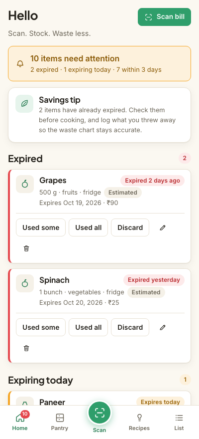
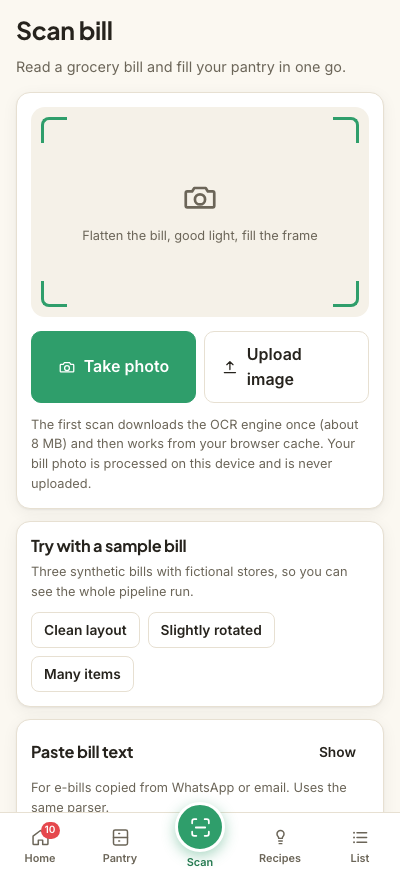
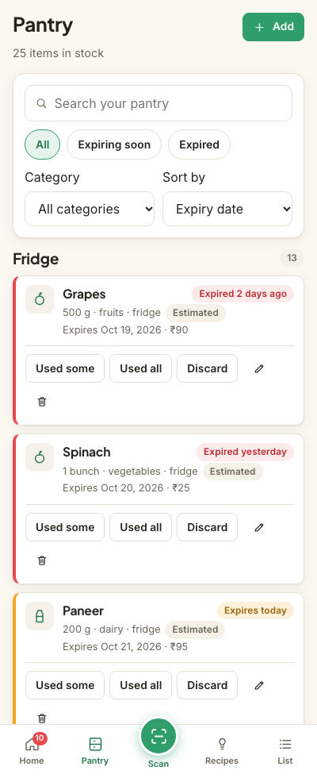
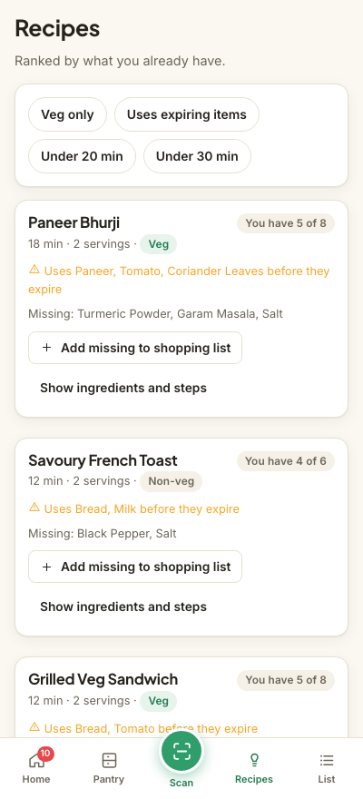
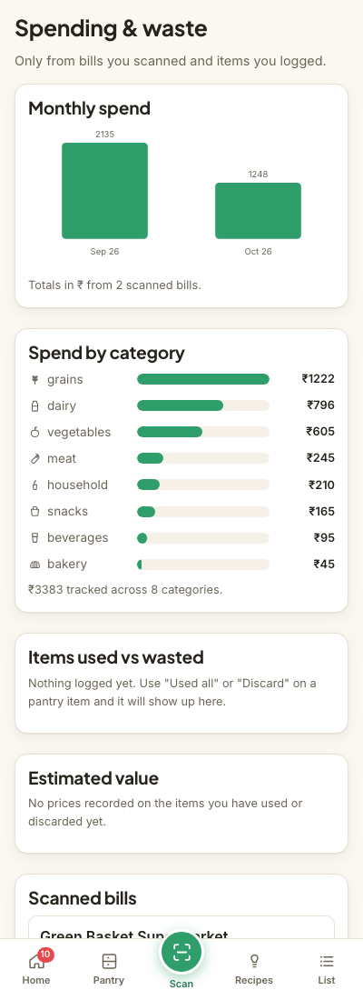
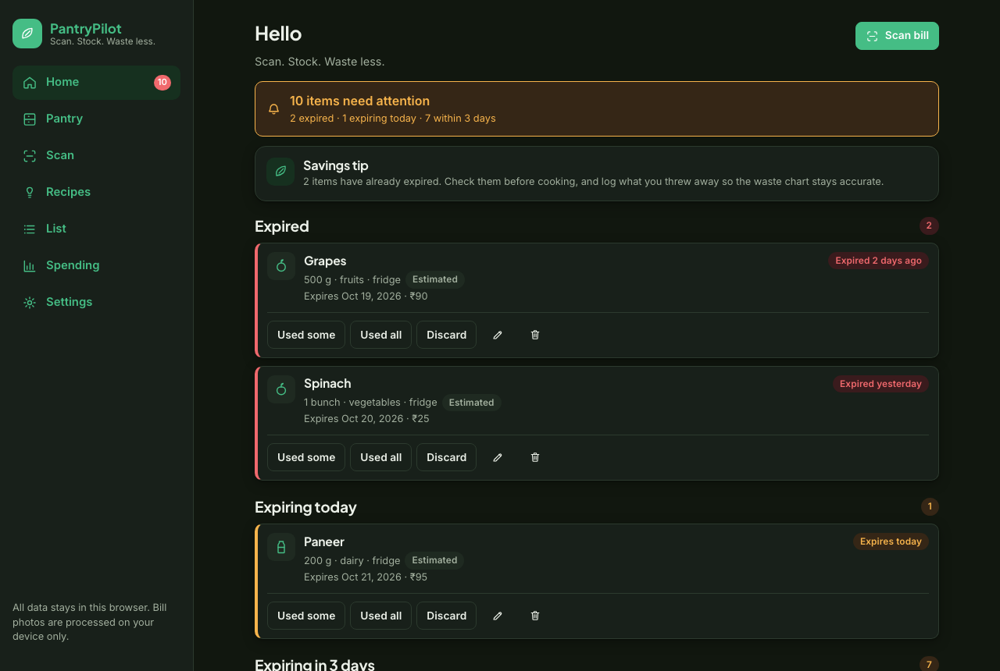

# PantryPilot

**Scan. Stock. Waste less.**

A mobile-first web app that tracks the food at home, warns you before it expires,
suggests recipes from what is actually in stock, and loads a whole shopping trip by
scanning the bill.

Everything runs in your browser. No accounts, no database, no API keys. Bill photos
are processed on your device and never leave it.

- **Live demo:** https://pantrypilot-six.vercel.app
- **Repository:** https://github.com/DIVYAPRIYADHARSHINI-GIT/pantrypilot



---

## Features

### Bill scanning (the main feature)
Photograph a grocery bill and PantryPilot reads it, matches each line against a
built-in grocery catalog, estimates expiry dates, and hands you an editable review
screen before anything is saved.

### Other ways to add items
- **Barcode scan** — the native `BarcodeDetector` API where supported, `@zxing/browser`
  as a fallback, or just type the number. Products are looked up in Open Food Facts.
- **Manual add** — with catalog autocomplete, shelf-life estimates and quick-add chips.

### Pantry and expiry
- Grouped by Fridge / Freezer / Shelf, with search, filters and sorting.
- Colour states per item: fresh (green), expiring within your warning window (amber),
  expired (red).
- Home screen shows "Expiring today", "Expiring in N days", "Expired" and "Use first".
- Item actions: Used some, Used all, Discard (counted as waste), Edit, Delete. When a
  quantity reaches zero the item is offered to the shopping list.
- In-app reminder banner and a nav badge. Browser notifications are optional and only
  fire while the app is open — there is no background push, because there is no server for it.

### Recipes
40 original recipes (Indian and general, veg and non-veg) ranked by how many
ingredients you already have, with extra weight for ingredients that expire soon.
Shows "You have 5 of 7 ingredients", the missing ones, and a button to add them to
the shopping list.

### Shopping list
Items arrive automatically when stock hits zero, or manually. Tick items off, grouped
by category, then "Move bought items to pantry" runs the same review flow with
estimated expiry dates.

### Spending and waste
Plain SVG charts: monthly spend from scanned bills, spend by category, items used vs
wasted, and the estimated value used vs wasted. When there is no data, the charts show
an empty state rather than invented numbers.

### Settings and backup
Warning days (default 3), default storage place and unit, currency (₹ default), theme,
and an editable default shelf life per category. JSON backup export/import and CSV
export of the pantry.

---

## How the bill scanning works

The whole pipeline runs in the browser. The photo is never uploaded.

1. **Capture** — `<input type="file" accept="image/*" capture="environment">` opens the
   phone camera, or you can upload an image or screenshot. A framing tip, rotate-90°
   buttons and a simple top/bottom crop are provided.
2. **Clean-up** (`src/lib/imagePrep.ts`) — the image is drawn to a canvas at ~1600px on
   the long edge, converted to grayscale (luma), contrast-stretched to the full range,
   and then **adaptive thresholded** using a local mean computed from an integral image.
   Adaptive thresholding is what makes unevenly lit phone photos readable. The cleaned
   image is shown as a preview, and a quick sharpness/ink check warns about a blurry or
   very dark photo before a slow OCR run.
3. **OCR** (`src/lib/ocr/`) — Tesseract.js **pinned to 7.0.0** (published 2025-12-15).
   The worker script, the WASM cores and the English `tessdata_fast` traineddata are
   copied into `static/tesseract/`, so **nothing loads from a CDN**. Tesseract is
   imported lazily (`await import(...)`) so it only ever loads on the scan page, and it
   runs inside a dedicated **Web Worker** so the page never freezes. There is a progress
   bar, a Cancel button and a 60-second timeout with a friendly message.
4. **Parsing** (`src/lib/parser.ts`) — a pure, unit-tested module turns the raw text into
   structured data:
   - Extracts the **store name** (top lines), **bill date** (day-first for Indian bills,
     plus ISO and "12 Mar 2026" styles) and **bill total** (`TOTAL`, `GRAND TOTAL`,
     `NET AMOUNT`, `AMOUNT PAYABLE`, including the case where the figure is on the next line).
   - Detects **item lines**: item text followed by a trailing amount, and the case where
     the price sits on the following line. Handles `2 x 45.00`, `2 @ 45`, `500 G`,
     `1.5 KG`, `1 PKT` and leading counts.
   - Rejects **non-item lines**: GSTIN/PAN/FSSAI, phone numbers, invoice and bill numbers,
     CGST/SGST/IGST/TAX, DISCOUNT, ROUND OFF, CASH/CARD/UPI/CHANGE, addresses, column
     headers, item-count lines, delivery and packing fees.
   - Repairs common **OCR digit mistakes** (`O→0`, `l/I→1`, `S→5`, `B→8`, comma vs period)
     **only inside price and quantity fields**, so `SOAP` never becomes `50AP`.
   - Cleans **item names**: expands a bundled abbreviation dictionary (`MLK→Milk`,
     `PNR→Paneer`, `TMT→Tomato`, `ONN→Onion`, `BTR→Butter`, `CHKN→Chicken`, …), removes
     HSN codes and pack-size noise, and applies title case.
   - **Matches the catalog** (`src/lib/matcher.ts`): ~300 common grocery items (Indian and
     general) with aliases, matched by token overlap plus a fuzzy score (Dice bigrams and
     edit distance). Each entry carries a category, default storage place, default unit
     and typical shelf life. Unmatched lines become "Other" with a low-confidence flag.
     Non-food lines (bags, detergent, soap) are flagged and left unchecked by default.
   - **Sanity check**: if the sum of item amounts differs from the bill total by more than
     3%, it shows *"Some items may be missing or misread. Please review."*
5. **Review screen** — mandatory before anything is saved. The receipt image sits on top
   (tap to zoom) with an editable list below: checkbox, name (with catalog autocomplete),
   quantity, unit, category, storage place, price and expiry date. Expiry dates come from
   the catalog's shelf life and carry an **"Estimated"** badge. Low-confidence rows are
   highlighted. There are "Add missing item" and "Delete row" buttons and a running
   selected-count/total summary.
6. **Saving** — selected rows go into the pantry; if an item already exists you are asked
   whether to increase its quantity instead of creating a duplicate. A receipt record
   (store, date, total, item count, category totals) is stored for the charts.
   **The photo itself is not stored.**

**Fallbacks:** a "Paste bill text" box runs the same parser (for e-bills copied from
WhatsApp or email), and manual add is always one tap away. The flow never dead-ends —
every error state offers paste-text and manual-add routes.

---

## Measured accuracy

OCR on crumpled or faded bills is imperfect, so here are real numbers rather than a claim.

**Parser unit tests** — 77 tests over 12 sample OCR text blocks, including deliberately
messy ones (heavy `O/0` and `S/5` confusion, abbreviated names, price-on-next-line,
rate columns, bullet-point WhatsApp bills, bills with no total):

```
Test Files  1 passed (1)
     Tests  77 passed (77)
```

**End-to-end OCR on generated bill images** — each image is driven through the real
`/scan` page in headless Chromium (canvas clean-up → Tesseract Web Worker → parser), and
the resulting review rows are scored against the expected item list:

| Test bill | Items found | Accuracy | Time |
| --- | --- | --- | --- |
| Clean layout | 6/6 | 100% | 1.4s |
| Slightly rotated (3°) | 5/5 | 100% | 0.7s |
| Low contrast / faded | 5/5 | 100% | 0.7s |
| Many items (21 lines) | 21/21 | 100% | 1.4s |
| Different layout (S.No columns) | 6/6 | 100% | 0.7s |
| **Overall** | **43/43** | **100%** | |

Reproduce with `npm run build && npm run preview`, then `node tests/ocr-accuracy.mjs`.

**Honest caveat:** these are clean, synthetic, computer-rendered bills, which is the
best case for OCR. Real thermal-printer receipts that are crumpled, faded, curled or
photographed in poor light will do noticeably worse — that is exactly why the review
screen is mandatory and why every number stays editable. PantryPilot does not claim
100% accuracy on real-world bills.

**Full-flow browser tests** — 68 checks covering scan → review → edit → add to pantry →
duplicate merge → pantry view → used/discard/delete → shopping list → recipes → barcode
(found and not-found) → charts → backup/import, on mobile (400px and 360px), desktop
(1280px) and dark mode:

```
68 passed, 0 failed
```

---

## Tech stack

- **SvelteKit 3** + **Svelte 5** (runes) + **TypeScript**
- **`@sveltejs/adapter-vercel`** (nodejs22.x), deployed on the Vercel Hobby plan
- **Tesseract.js 7.0.0**, self-hosted in `static/tesseract/`, lazily loaded, in a Web Worker
- **`@zxing/browser`** as the barcode fallback reader
- **localStorage** for pantry, shopping list, receipts, waste log and settings — every
  access is wrapped in try/catch, with graceful handling when storage is full or disabled
- **Vitest** for unit tests, **Playwright** for the OCR-accuracy and end-to-end suites
- Plain SVG charts and original SVG icons. No UI framework, no emoji, no copyrighted images.

### Only one server route
`GET /api/barcode/[code]` proxies Open Food Facts. It exists because the API asks for a
descriptive `User-Agent`, which a browser `fetch` cannot set. It sends only the barcode
number, caches responses for 24 hours, and handles not-found and timeouts. Everything
else in the app runs in the browser.

### Project structure

```
src/lib/
  parser.ts        bill text -> structured data (unit tested)
  matcher.ts       catalog matching, name cleaning, abbreviations
  catalog.ts       ~300 grocery items + abbreviation dictionary
  shelfLife.ts     shelf-life estimator (unit tested)
  rank.ts          recipe ranking (unit tested)
  recipes.ts       40 original recipes
  dates.ts         local-date helpers, never shift a day
  imagePrep.ts     canvas resize / grayscale / contrast / adaptive threshold
  ocr/provider.ts  OcrProvider interface + browser Tesseract provider
  ocr/ocrWorker.ts the Web Worker that runs Tesseract
  store.svelte.ts  app state (runes) + localStorage persistence
src/routes/
  /                home: expiring lists and savings tip
  /scan            the bill-scanning hero flow
  /pantry /add /barcode /recipes /list /charts /settings
  /api/barcode/[code]   the only server route
static/tesseract/  self-hosted OCR engine, WASM cores and traineddata
static/samples/    3 synthetic sample bills for "Try with a sample bill"
tests/             OCR accuracy harness, e2e suite, generated test bills
```

### Date handling
All dates are plain `YYYY-MM-DD` strings interpreted in local time.
`Date.toISOString()` is never used for a calendar date, because converting to UTC can
shift the day across a time-zone boundary. Month-end, year-end and leap behaviour is
covered by unit tests.

---

## Sample data

A first visit pre-loads about 25 pantry items with a realistic mix of expiry states
(fresh, expiring today, expiring soon, already expired), 2 sample receipt records, and
a "Try with a sample bill" button that runs the whole scan pipeline on 3 bundled
synthetic bill images. The bills are generated by `scripts/make-bills.mjs` with
fictional store names in different layouts — no real store branding and no real
customers' bills. A "Start fresh" button in Settings clears everything.

---

## Setup

```bash
git clone https://github.com/DIVYAPRIYADHARSHINI-GIT/pantrypilot.git
cd pantrypilot
npm install
npm run dev          # http://localhost:5173
```

Other commands:

```bash
npm run test         # 77 parser / matcher / shelf-life / ranking unit tests
npm run build        # production build
npm run preview      # serve the production build on :4173

# browser suites, against a running preview server
node tests/ocr-accuracy.mjs   # real OCR on the 5 generated test bills
node tests/e2e.mjs            # 68 full-flow checks
node scripts/make-bills.mjs   # regenerate the sample + test bill images
```

No environment variables and no API keys are required.

### Optional cloud OCR
`src/lib/ocr/provider.ts` defines an `OcrProvider` interface. The browser Tesseract
provider is the default and the only one that ships enabled; a cloud vision provider
could be added behind an environment variable. The app works fully without one.

---

## Privacy

- All your data stays in this browser's local storage. There is no account and no database.
- Bill photos are processed on your device only. They are never uploaded and never saved —
  only the parsed totals are stored for the charts.
- The single network call the app makes is the barcode lookup, which sends only the
  barcode number to Open Food Facts.

## Data credits

Product data from [Open Food Facts](https://world.openfoodfacts.org), open data made
available under the [Open Database License (ODbL)](https://opendatacommons.org/licenses/odbl/1-0/).
OCR by [Tesseract.js](https://github.com/naptha/tesseract.js), self-hosted and run on
your device. English language data from
[tessdata_fast](https://github.com/tesseract-ocr/tessdata_fast) (Apache 2.0).

## Screenshots

| Scan | Pantry | Recipes |
| --- | --- | --- |
|  |  |  |

| Spending & waste | Desktop, dark mode |
| --- | --- |
|  |  |
